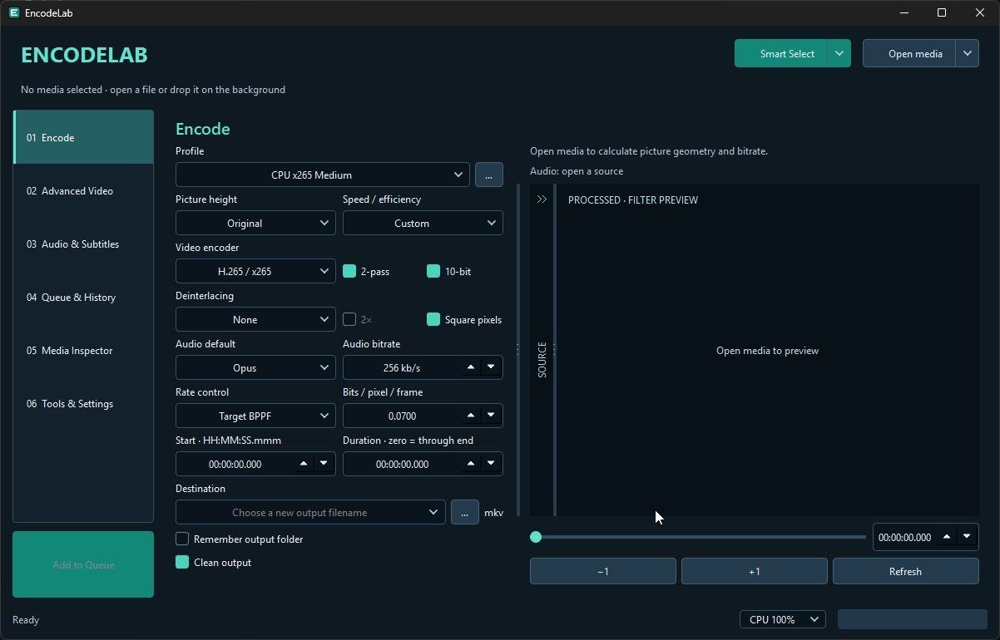
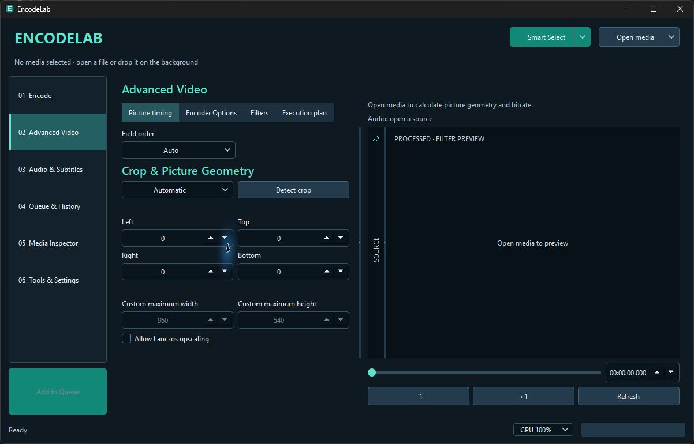

# EncodeLab — Special Thanks & Acknowledgements

EncodeLab builds on years of generous work by open-source developers. Thank you to the people who make dependable media tools, codecs and video processing available to everyone.

### Media and codecs

[FFmpeg / FFprobe](https://ffmpeg.org/) · [x264](https://www.videolan.org/developers/x264.html) · [x265](https://www.videolan.org/developers/x265.html) · [Opus](https://opus-codec.org/) · [MKVToolNix](https://mkvtoolnix.download/)

### Video processing

[VapourSynth](https://www.vapoursynth.com/) · [QTGMC / havsfunc authors](https://github.com/HomeOfVapourSynthEvolution/havsfunc) · [MVTools](https://github.com/dubhatervapoursynth/vapoursynth-mvtools) · [znedi3](https://github.com/sekrit-twc/znedi3) · [fmtconv](https://github.com/EleonoreMizo/fmtconv)

### Application foundations

[Python](https://www.python.org/) · [Qt / PySide6](https://doc.qt.io/qtforpython/) · [NumPy](https://numpy.org/) and their contributors.

We also thank [FFMS2](https://github.com/FFMS/ffms2) for its contribution to the wider video ecosystem; it is not bundled in this candidate. These credits do not imply affiliation or endorsement. [Full acknowledgements and component terms](THIRD_PARTY_CREDITS.md) recognise the wider dependency stack.

## Introducing EncodeLab

EncodeLab is a Windows x64 video-transcoding application being prepared for portable distribution. It brings CPU and GPU encoding, picture processing, stream management and a persistent queue into one interface.

## Features

- CPU x264/x265, including genuine video two-pass encoding.
- NVIDIA NVENC, Intel QSV and AMD AMF, subject to compatible hardware and drivers.
- Experimental full-video and opening-range calibrated quality selection, with CPU/OpenCL analysis options. Analysis selects a quality value; the ordinary encoder pipeline then performs the final encode. It cannot guarantee an exact bitrate or file size.
- QTGMC Fast, Balanced and High Quality, plus standard deinterlacing; crop, aspect-ratio handling and bounded/custom resolutions.
- Audio, subtitle, chapter and additional-stream selection; Fast Copy / Remux.
- Batch queue and history, completed-media protection and direct FFmpeg processing.
- Clean Output metadata handling and newly measured MKV track statistics through MKVToolNix.

## Screenshots

Genuine captures of the current private candidate, using isolated fresh settings and blank previews:

These are genuine captures of the newly branded private candidate, not mock-ups or an announcement of a public release.

## How to Use

1. Open media, or drop a supported source onto a general background area.
2. Choose a profile, picture settings and the tracks to keep. Specialised track-import regions retain their separate purpose.
3. Choose a new destination and add the job to the queue.
4. Start the queue and review the completed result.

The intended distribution is a complete extracted folder: keep its executable, `_internal` and `vendor` folders together. It needs a writable user location and compatible Windows x64 hardware. Hardware encoding requires the corresponding installed GPU driver. Current testing is on the development Windows host; a remaining QTGMC runtime dependency and clean-PC validation must be resolved before describing it as installer-free on every supported machine.

## Development Status

EncodeLab is under private review and public-release preparation. The application, dependency source materials and redistribution conditions are being audited. No public binary release is currently approved.

## Licensing and Third-Party Information

EncodeLab's own source licence has **not yet been selected**. Bundled projects retain their own licences; this page does not relicense them. See [credits](THIRD_PARTY_CREDITS.md), [staged legal texts](THIRD_PARTY_NOTICES/INDEX.md), [source availability](SOURCE_AVAILABILITY.md) and [release status](RELEASE_STATUS.md).

## Downloads

**Public portable download: Not yet available.**
